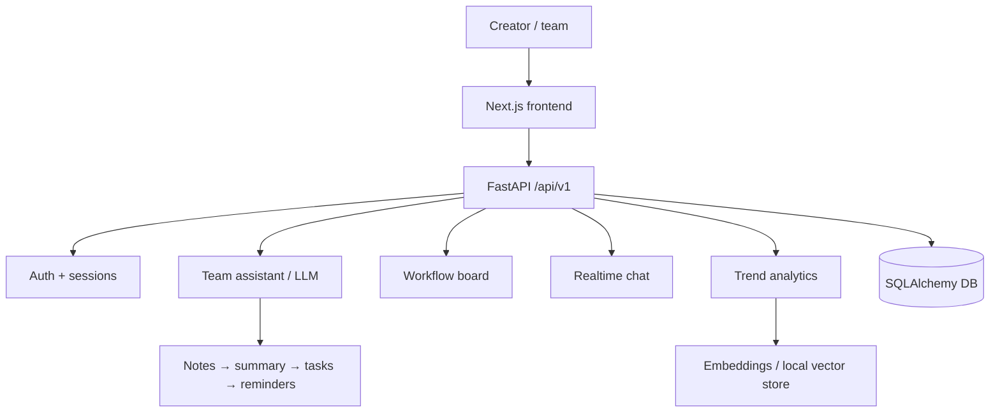

# Trend Pilot — Agentic Trend Orchestrator

[](https://project-l0sn8.vercel.app)
[](https://github.com/ShamikOfficial/agentic-trend-orchestrator/actions/workflows/ci.yml)
[](LICENSE)
[]()
[]()

**Flagship project.** Full-stack agentic workspace for creator teams: trend discovery, AI task extraction, workflow boards, and real-time chat — with a FastAPI backend, Next.js frontend, and persistence.

Portfolio case study: [shamik-basu.com](https://www.shamik-basu.com) · Live app: [project-l0sn8.vercel.app](https://project-l0sn8.vercel.app)

---

## Why this repo (for hiring managers)

This is the primary public proof of **AI / ML systems engineering** in my portfolio:

| Signal | What’s in the repo |
|--------|--------------------|
| Product surface | Auth, team assistant, kanban workflows, chat, trend analytics UI |
| Backend | FastAPI, SQLAlchemy + Alembic, session auth, LLM-backed services |
| Frontend | Next.js App Router, TypeScript, Tailwind / shadcn |
| Reliability | Backend pytest suite (dedupe, persistence, schedule extract, LLM transient handling) |
| Ops | Docker-ready API, Vercel frontend, Railway notes in `docs/` |

I am continuing active work on evals, agent reliability, and production hardening here.

---

## Architecture



**Request path:** browser → Next.js → `NEXT_PUBLIC_API_BASE_URL` → FastAPI. Protected routes require `x-auth-token` (except health + login/register).

Details: [`docs/api-contract.md`](docs/api-contract.md), [`docs/api-coverage-matrix.md`](docs/api-coverage-matrix.md).

---

## What’s implemented vs still building

| Area | Status | Notes |
|------|--------|-------|
| Auth + session gate | Done | Register / login / me |
| Team assistant | Done / evolving | Notes → summaries → tasks |
| Workflow board | Done | Stages, milestones, uploads |
| Chat | Done | DMs, groups, join requests |
| Trend detection UI | Building | Backend analytics under `backend/trend_analytics/` |
| Offline eval harness | Planned | Next focus (tomorrow+) — failure cases, regression checks |
| Hardened production auth | Partial | Local MVP still uses simplified auth store — not production-grade |

Honesty matters: some portfolio metrics are product experiments; this README tracks what the code actually ships.

---

## Known limitations / failure modes

- **Auth:** passwords in the local MVP store are not production-hardened (see Notes). Do not treat this as a security reference implementation.
- **LLM variability:** task extraction and summaries can drift; tests cover dedupe, scheduling extract, and transient LLM error paths — not full answer quality scoring yet.
- **External deps:** trend / embedding paths degrade when optional services are unset; health flags can report static placeholders.
- **CORS / deploy:** frontend on Vercel expects a reachable API with correct `CORS_ORIGINS`.
- **Data:** local SQLite / file stores are for demo; production would use managed Postgres + secrets.

---

## Quick start

### Backend

```powershell
python -m venv .venv
.\.venv\Scripts\Activate.ps1
pip install -r requirements.txt
Copy-Item .env.example .env
python -m uvicorn backend.app.main:app --reload --host 127.0.0.1 --port 8000
```

### Frontend

```powershell
cd frontend
npm install
Copy-Item .env.example .env.local
npm run dev
```

Open `http://localhost:3000`. API default: `http://127.0.0.1:8000/api/v1`.

### Tests

```powershell
python -m pytest backend/tests -q
```

CI runs the same backend tests on push/PR (see `.github/workflows/ci.yml`).

---

## Repository layout

```
agentic-trend-orchestrator/
├── backend/           FastAPI app, services, models, tests
│   ├── app/
│   ├── tests/
│   └── trend_analytics/
├── frontend/          Next.js application
├── docs/              API contract, coverage, deploy guides
├── data/              Local DB placeholders (gitignored content)
└── .github/workflows/ CI
```

---

## Deploy

- **Frontend:** Vercel — set Root Directory to `frontend`, set `NEXT_PUBLIC_API_BASE_URL` (must end with `/api/v1`).
- **Backend:** Docker / Railway — see [`docs/railway-deploy.md`](docs/railway-deploy.md) and [`docs/production-launch-guide.md`](docs/production-launch-guide.md).

---

## Tech stack

| Layer | Tools |
|-------|-------|
| Frontend | Next.js, React, TypeScript, Tailwind, shadcn/ui |
| Backend | FastAPI, Python 3.10+, SQLAlchemy, Alembic |
| AI | LLM-backed assistant + trend analytics modules |
| Deploy | Vercel, Docker-ready API |

---

## License

MIT — see [LICENSE](LICENSE).
